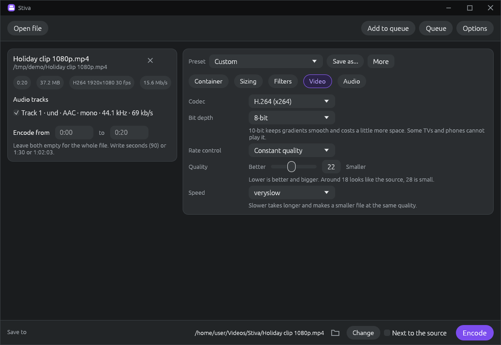

<div align="center">


# Stiva

**A video converter for Windows 11.** Open a file, pick a preset, press Encode.<br>
[ffmpeg](https://ffmpeg.org) does the work; Stiva only makes it pleasant.

[](LICENSE)
[](#requirements)
[](https://www.rust-lang.org)
[](https://ffmpeg.org)

[Features](#features) · [Install](#install) · [Quick start](#quick-start) · [What has been tested](#what-has-been-tested) · [Troubleshooting](#troubleshooting) · [Building](#building-from-source)



</div>

The layout follows [VidCoder](https://github.com/RandomEngy/VidCoder): the file on the left, the settings on the right, the queue one button away. The colours and the manners follow [Camallo](https://github.com/echidistanti/camallo), a downloader by the same author. Stiva is not affiliated with either.

> **Status: version 0.1, one person's project.** It works on the author's computer, and the list of what has and has not been tried on real hardware is [further down](#what-has-been-tested). Read it before trusting Stiva with the only copy of something.

## Contents

- [Features](#features)
- [Screenshots](#screenshots)
- [Requirements](#requirements)
- [Install](#install)
- [Quick start](#quick-start)
- [The settings, tab by tab](#the-settings-tab-by-tab)
- [Presets](#presets)
- [The queue and *When done*](#the-queue-and-when-done)
- [Keyboard and command line](#keyboard-and-command-line)
- [Where things are stored](#where-things-are-stored)
- [Privacy](#privacy)
- [What has been tested](#what-has-been-tested)
- [Troubleshooting](#troubleshooting)
- [FAQ](#faq)
- [How it works](#how-it-works)
- [Building from source](#building-from-source)
- [Releases and the installer](#releases-and-the-installer)
- [Repository layout](#repository-layout)
- [Contributing](#contributing)
- [Known limits](#known-limits)
- [Third-party software](#third-party-software)
- [Licence](#licence)

## Features

**Formats.** Anything ffmpeg can read goes in. Out come MP4, MKV, WebM, MP3, M4A, Opus or FLAC.

**Video.** x264, x265, SVT-AV1 and VP9 in software; AMD AMF, NVIDIA NVENC and Intel QSV in hardware (H.264, HEVC and AV1, where the card has them). 8-bit or 10-bit. Constant quality, average bitrate, or a target file size, with two passes where the encoder allows. Stiva asks ffmpeg which encoders exist and then tries each one on a few black frames, so the list shows only what this computer can really start.

**Audio.** AAC, MP3, Opus, Vorbis, AC-3, FLAC, copy as it is, or none. Mixdown to mono, stereo or 5.1. Pick which tracks to keep.

**Picture.** Fit inside a largest size (never enlarging), crop (none, automatic, manual), rotate, flip, deinterlace, detelecine, denoise, sharpen, grayscale, and a free field for your own ffmpeg filter.

**Subtitles and chapters.** Choose the subtitle tracks to keep. Chapters travel along in MKV.

**A piece of the file.** Encode from one time to another instead of the whole thing.

**Presets.** Eleven come with the program. Your own are one small JSON file each; export and import them to move between computers.

**Queue.** Add files and walk away. Pause, stop, run a failed one again. The queue is still there after you close the program.

**When done.** Do nothing, open the folder, close Stiva, sleep, or shut down.

**Windows touches.** A notification when the work ends and the window is not in front. The progress on the taskbar button. Drag and drop. A per-user installer.

## Screenshots

| The queue | Encoding |
| :---: | :---: |
|  |  |

The screenshots are renderings from Linux, where the author builds the program, with invented file names. The Windows window has the same content.

## Requirements

- Windows 11, 64-bit. This is what Stiva is made and tried on. Windows 10 may work; nobody has checked.
- A few hundred megabytes of disk space for ffmpeg, which Stiva downloads on first start (the download is about 75 MB). You can use your own ffmpeg instead.
- For hardware encoding, a graphics card and driver that support it. Software encoders need nothing special.
- A window of at least 900 × 600 pixels.

Linux builds and runs for development, using the ffmpeg installed on the system. It is not a supported platform. There is no macOS version.

## Install

> The first release is not published yet. Until it is, [build from source](#building-from-source).

**Installer (recommended).** Download `stiva-<version>-windows-x64-setup.exe` from the [Releases](https://github.com/echidistanti/stiva/releases) page and run it. It installs for your user only, so it never asks for administrator rights. It adds a Start menu entry and, if you tick the box, a desktop shortcut. Uninstalling asks whether to remove Stiva's own data as well (settings, presets, the downloaded ffmpeg, logs). It never touches your videos.

**Portable.** Download `stiva-<version>-windows-x64.7z`, unpack it anywhere and run `stiva.exe`. It is a single file of about 10 MB.

**First start.** Stiva downloads ffmpeg from [gyan.dev](https://www.gyan.dev/ffmpeg/builds/), checks its SHA-256 against the one published next to it, and unpacks `ffmpeg.exe` and `ffprobe.exe`. If you already have ffmpeg, choose *Options → ffmpeg → From the folder you chose* and point Stiva at the folder.

**SmartScreen.** Stiva is not code signed, so Windows may warn the first time: *More info → Run anyway*. The source is here, and you can build the exe yourself.

## Quick start

1. **Open a file**: *Open file*, `Ctrl+O`, or drop it on the window.
2. **Pick a preset** at the top of the settings. Change what you like in the tabs; each option has a line saying what it does.
3. **Check *Save to*** at the bottom. The default is `Videos\Stiva`; the box *Next to the source* saves each file beside its original.
4. **Encode**, or *Add to queue* and open the next file. The *Queue* button counts what is waiting.

If a file with that name already exists, Stiva adds a number to the new one. *Options → If the file exists* can overwrite it, skip it, or ask each time.

Drop several files at once and they all go to the queue with the settings of that moment.

## The settings, tab by tab

| Tab | What is in it |
| --- | --- |
| **Container** | MP4, MKV, WebM, MP3, M4A, Opus, FLAC. A line says what each one can hold. |
| **Sizing** | As the source, or a largest width and height to fit inside. Bigger pictures are scaled down, smaller ones are left alone. |
| **Filters** | Crop, rotate, flip, deinterlace, detelecine, denoise, sharpen, grayscale, custom filter. |
| **Video** | Codec, bit depth, rate control (quality, bitrate, target size, two passes), speed. |
| **Audio** | Codec, bitrate, mixdown. |

The card on the left lists the audio tracks and subtitles of the file (*Tracks and range*) and the *Encode from … to …* fields. Write times as `90`, `1:30` or `1:02:03`; leave both empty for the whole file.

## Presets

| Preset | What it makes |
| --- | --- |
| **Web 1080p** | MP4, x264, quality 22, up to 1920×1080, stereo AAC 160 kb/s |
| **Web 720p** | MP4, x264, quality 23, up to 1280×720, stereo AAC 128 kb/s |
| **Mobile 480p** | MP4, x264, quality 24, up to 854×480, stereo AAC 96 kb/s |
| **Storage 1080p** | MP4, x264, quality 27 with the slow speed, up to 1920×1080, stereo AAC 128 kb/s: small files |
| **Storage 720p** | the same at up to 1280×720, quality 26 |
| **Archive H.265 10-bit** | MKV, x265 10-bit, quality 20, slow, audio copied untouched |
| **Small AV1 10-bit** | MKV, SVT-AV1 10-bit, stereo Opus 128 kb/s |
| **WebM VP9 1080p** | WebM, VP9, up to 1920×1080, stereo Opus 128 kb/s |
| **Music MP3 192** | audio only, MP3 192 kb/s |
| **Music AAC 192** | audio only, M4A, AAC 192 kb/s |
| **Lossless FLAC** | audio only, FLAC |

Built-in presets cannot be changed or deleted; *Save as…* makes your own copy. The *More* button next to them exports a preset to a file, imports one, or deletes one of yours. Your presets live in `%LOCALAPPDATA%\Stiva\presets`, one JSON file each, so you can also copy them by hand.

## The queue and *When done*

The *Queue* button opens the list, with *Queued* and *Completed* pages. A running job shows its progress, speed and time left, and a *Log* panel with what ffmpeg says. *Pause* suspends the ffmpeg process, so a paused encode uses no processor; *Stop* ends it and removes the half-written file. A job that failed has *Run again*. Files are converted one after the other.

*When done* sits in the queue page (and next to the progress while one file runs):

| Choice | What happens at the end |
| --- | --- |
| Do nothing | Nothing more. |
| Open the folder | Explorer opens on the output folder. |
| Close Stiva | The program quits. |
| Sleep | After 15 seconds, with *Cancel* and *Now*. |
| Shut down | After 60 seconds, with *Cancel* and *Now*. |

Except for Sleep and Shut down, a notification tells you the work is over if Stiva is not the window in front. Sleep and shut down happen only if at least one file was actually finished, and Stiva does not force them: if another program objects, the computer stays on. The choice is not remembered between runs, on purpose: nobody wants a computer that shuts down because of what was clicked last month.

## Keyboard and command line

| Keys | What it does |
| --- | --- |
| `Ctrl+O` | Open a file |
| `Ctrl+Enter` | Encode (or encode the queue) |
| `Space` | Pause and resume, while encoding |
| `Esc` | Close a dialog |

Files can be passed on the command line: `stiva.exe holiday.mp4` opens it for setting up, and several files go straight to the queue.

## Where things are stored

Everything is under `%LOCALAPPDATA%\Stiva`:

| What | Where |
| --- | --- |
| Settings | `settings.json` |
| Your presets | `presets\` |
| The queue | `queue.json` |
| ffmpeg and ffprobe | `bin\` |
| Logs, one per encode, plus `encoders.txt` (what the encoder test found) | `logs\` |

The one other thing Stiva writes outside that folder is the registry key `HKCU\Software\Classes\AppUserModelId\Stiva`. It gives the notification its name and icon. The installer adds it too and removes it on uninstall.

Videos go where you say, by default `Videos\Stiva`.

## Privacy

- No accounts, no telemetry, no update check, no advertising.
- The only network request is the download of ffmpeg from gyan.dev (and its checksum file), on first start and when you press *Download again* in the options. Nothing about you or your files is sent.
- Your videos are read and written on your computer and nowhere else.

## What has been tested

An honest list, so nobody finds out at the worst moment.

**Tried by the author on a real Windows 11 computer** (a Geekom A7: AMD Ryzen, Radeon graphics):

- first start and the ffmpeg download;
- opening files, presets, saving presets, the queue, pause and stop;
- 8-bit and 10-bit with x264, x265, SVT-AV1 and VP9;
- the **AMD AMF** hardware encoders.

**Not tried on real hardware:** NVIDIA NVENC, Intel QSV, and hardware AV1 of any brand. They are driven the same way as AMF, and Stiva offers them only when ffmpeg can open them, but nobody has looked at a file they made.

**Checked by automated tests and by running on Linux, not yet tried on Windows:**

- filters, bitrate and target size, two passes, subtitles, chapters;
- the Windows notification, the taskbar progress, sleep and shut down;
- the installer.

The tests (`cargo test`, about 90) include real encodes with ffmpeg: they check that the command lines Stiva writes produce files with the right streams, size and length. They cannot check what a Windows machine does with a notification or a power command.

If something in the second or third list fails for you, please open an issue with the log (see [Contributing](#contributing)).

## Troubleshooting

**Stiva cannot download ffmpeg.** Check the connection, a proxy, or an antivirus that blocks the download, then press *Try again*. If gyan.dev is out of reach, download ffmpeg yourself and use *Options → ffmpeg → From the folder you chose* (the folder must hold `ffmpeg.exe` and `ffprobe.exe`).

**A hardware encoder is missing from the list.** Stiva lists an encoder only after ffmpeg has really started it on a few test frames. A missing one usually means the graphics driver is old or the card does not have it. `logs\encoders.txt` shows what each test said.

**It says "10-bit did not pass its test on this PC".** The same test, for 10-bit. The reason is in `logs\encoders.txt`. Software encoders do 10-bit anywhere.

**An encode failed.** Open the *Log* panel of the job (or the file in `logs\`): ffmpeg usually says what it did not like. *Run again* retries it. A wrong custom filter is the most common cause.

**The output has a number at the end of its name.** The file already existed. Change *If the file exists* in the options.

**No notification at the end.** It appears only when Stiva is not the window in front, and not when *When done* is Sleep or Shut down. Windows' focus assist or *Do not disturb* can also hide it.

**The computer did not sleep.** Stiva asks politely and does not force it; a program that objects wins.

**Windows SmartScreen blocks the exe.** See [Install](#install).

## FAQ

**Why not HandBrake or VidCoder?** They are good and much older, and if one of them does what you need, use it. Stiva exists because its author wanted a smaller program that stays close to ffmpeg, with hardware encoders and presets that fit on one screen.

**Can I see the ffmpeg command it runs?** Yes: the *Log* panel and the files in `logs\` start with the exact command line.

**Can I use my own ffmpeg?** Yes, *Options → ffmpeg → From the folder you chose*.

**Does it work on Linux or macOS?** Linux runs it for development with the system's ffmpeg, without support. macOS is not a target.

**Is the interface in other languages?** English only. The installer speaks English and Italian.

**Why is ffmpeg not inside the program?** The full builds are large and have their own licence (GPL). Stiva downloads one instead of redistributing it, and the exe stays small.

## How it works

Stiva runs `ffprobe` on the file to learn its streams, builds one ffmpeg command line from the settings (`encode.rs`), starts ffmpeg without a console window, and reads its `-progress` output to draw the bar. ffmpeg is started directly, never through a shell; the file names go as arguments. Pause suspends the ffmpeg process and resume wakes it; stop ends it and removes the half-written file. Presets, settings and the queue are plain JSON, written to a temporary file first and renamed, so a crash cannot leave half a file.

Before offering an encoder, `caps.rs` asks `ffmpeg -encoders` what exists and then encodes a few black frames with each candidate, in 8-bit and 10-bit, to see which really start on this computer.

The notification is a short PowerShell script started with `-EncodedCommand`; the texts reach it through environment variables, so no file name is ever pasted into a script. The taskbar progress is the Windows `ITaskbarList3` interface.

The program is written in Rust with [egui](https://github.com/emilk/egui). The interface is immediate mode: every frame it draws from the state in `app.rs`, and what the user did comes back as a list of actions applied afterwards.

## Building from source

You need Rust 1.85 or newer (edition 2024).

```sh
cargo run                                              # a debug build, on Windows or Linux
cargo fmt                                              # the project style, see rustfmt.toml
STIVA_FFDIR=/usr/bin cargo test                        # the tests; the folder must hold ffmpeg and ffprobe
cargo build --release --target x86_64-pc-windows-gnu   # a Windows exe from Linux (needs mingw-w64)
```

Without `STIVA_FFDIR` and without ffmpeg on the path, the tests that make real encodes print a line and skip themselves. One more test checks the real gyan.dev archive; it runs only when `STIVA_TEST_7Z` names a downloaded one (about 75 MB).

On Windows with the MSVC toolchain, `cargo build --release` is enough. The icon and the version information are added by `build.rs`.

In debug builds a few environment variables help to try things without clicking: `STIVA_AUTOENCODE`, `STIVA_SHOW_OPTIONS`, `STIVA_TAB`, `STIVA_WHENDONE` and `STIVA_FFDIR`. The first four do nothing in release builds.

## Releases and the installer

A release has the portable `stiva-<version>-windows-x64.7z` attached. Publishing the release starts the **Installer** workflow (`.github/workflows/installer.yml`): it downloads that archive, builds the setup with [Inno Setup](https://jrsoftware.org/isinfo.php) from `installer/stiva.iss`, and attaches `stiva-<version>-windows-x64-setup.exe` to the same release. It can also be started by hand with the tag name.

The installer works per user (`%LOCALAPPDATA%\Programs\Stiva`), gives the shortcuts the same application identity as the program so notifications show Stiva's name, and on uninstall asks before removing the program's data.

## Repository layout

| Path | What is in it |
| --- | --- |
| `src/app.rs` | the state of the program, the queue runner, the messages from the worker threads |
| `src/view.rs` | every screen, drawn with egui |
| `src/ui.rs` | the small widgets and the colours |
| `src/encode.rs` | the ffmpeg command line, the run, progress, pause and stop |
| `src/model.rs` | the settings of one encode and what they mean |
| `src/caps.rs` | which encoders ffmpeg has and which can really start |
| `src/filters.rs` | the video filter chain |
| `src/probe.rs` | reading a file with ffprobe |
| `src/presets.rs` | the built-in presets and the user's |
| `src/queue.rs` | the queue and its file |
| `src/after.rs` | *When done*, the summary text, the taskbar state |
| `src/platform.rs` | the Windows-only parts: notification, taskbar, sleep, shut down |
| `src/deps.rs` | downloading and checking ffmpeg |
| `src/settings.rs` | the settings file |
| `src/strings.rs` | every text the user can read |
| `installer/stiva.iss` | the Inno Setup script |
| `.github/workflows/` | the installer workflow |
| `assets/` | the icon in the sizes the program and the installer need |
| `docs/` | the screenshots in this README |

## Contributing

Bug reports are welcome and are the most useful thing at this stage, especially from hardware the author does not have (NVIDIA, Intel, other AMD cards) and from Windows 10.

**An issue should have:** the Stiva version, the Windows version, the graphics card and driver, what you did, what you expected, and the log of the job (the *Log* panel, or the file in `%LOCALAPPDATA%\Stiva\logs`; `encoders.txt` for a missing encoder). Please look through the log before posting it and remove anything private, such as folder names.

**A pull request** is easiest when it is small and does one thing. Before sending it:

- `cargo fmt` and `STIVA_FFDIR=/path/to/ffmpeg cargo test` pass, and there are no new warnings;
- every text the user can read goes in `src/strings.rs`, in plain English, short, with the action first;
- a change to the command line has a test that makes a real file and checks it with ffprobe;
- Windows-only code sits behind `#[cfg(windows)]` with a stub elsewhere, so the project still builds and tests on Linux.

## Known limits

- Rows in the queue cannot be selected, so there is no `Delete` key for them; each row has its own remove button.
- Not code signed.
- The interface is in English only.
- Windows 11 is the only system it has been tried on, and AMD AMF the only hardware encoder.

## Third-party software

- **ffmpeg** is not part of Stiva. It is downloaded on first start from gyan.dev (the "release-full" build), or taken from the folder you choose. It has its own licence, which for the full build is GPL v3; see [ffmpeg.org/legal.html](https://ffmpeg.org/legal.html).
- [egui and eframe](https://github.com/emilk/egui), [rfd](https://github.com/PolyMeilex/rfd), [ureq](https://github.com/algesten/ureq), [serde](https://serde.rs), [sevenz-rust2](https://github.com/hasenbanck/sevenz-rust2), [windows-rs](https://github.com/microsoft/windows-rs) and the other crates in `Cargo.toml`, each under its own licence.
- The installer is built with [Inno Setup](https://jrsoftware.org/isinfo.php).
- The font is the one egui ships.
- The layout is inspired by [VidCoder](https://github.com/RandomEngy/VidCoder). No code from it is used.

## Licence

MIT. See [LICENSE](LICENSE).
