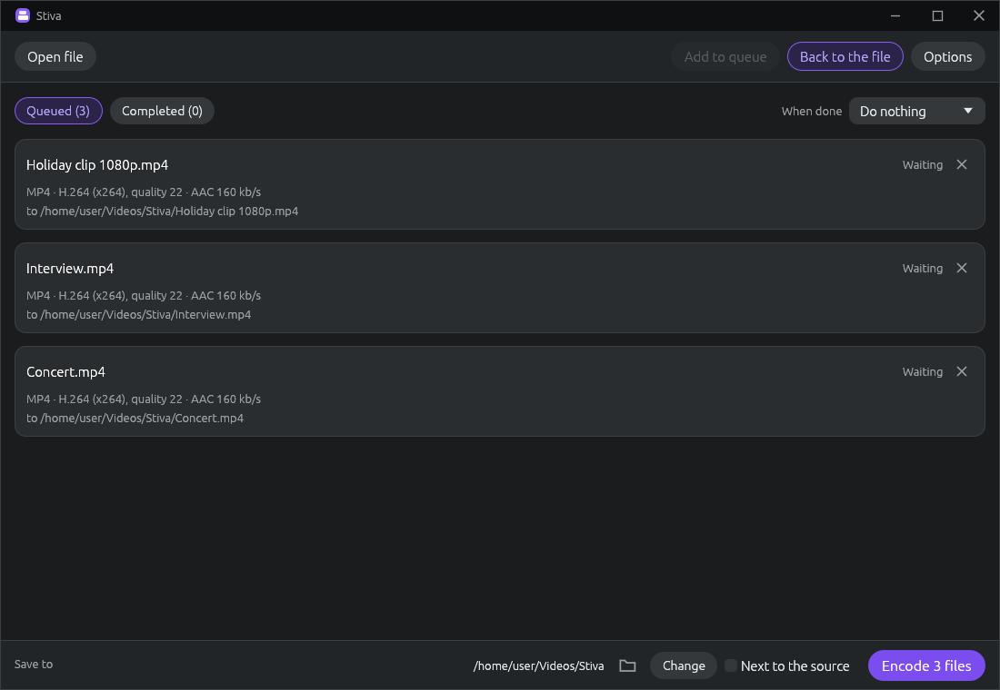

# Stiva

A video converter for Windows 11. You open a file, pick a preset, press Encode. The work is done by [ffmpeg](https://ffmpeg.org), which Stiva downloads for you the first time it runs.

The layout follows [VidCoder](https://github.com/RandomEngy/VidCoder): the file on the left, the settings on the right, a queue behind a button. The colours and the feel follow [Camallo](https://github.com/echidistanti/camallo).


## What it does

- Converts any video or audio file that ffmpeg can read, to MP4, MKV, WebM, MP3, M4A, Opus or FLAC.
- Eleven built-in presets (Web 1080p, Web 720p, Mobile 480p, Storage 1080p, Storage 720p, Archive H.265 10-bit, Small AV1 10-bit, WebM VP9 1080p, Music MP3 192, Music AAC 192, Lossless FLAC), and your own: change anything, press *Save as…*, and the preset is a small JSON file you can copy to another computer.
- **Video**: x264, x265, SVT-AV1, VP9, and the hardware encoders AMD AMF, NVIDIA NVENC and Intel QSV (H.264, HEVC and AV1 where the card has them). 8-bit and 10-bit. Constant quality, average bitrate, or a target file size, with two passes where the encoder supports them. Stiva asks ffmpeg which encoders it has and which of them the computer can actually start, and greys out the rest.
- **Audio**: AAC, MP3, Opus, Vorbis, AC-3, FLAC, copy as is, or none. Mixdown to mono, stereo or 5.1. Choose which tracks to keep.
- **Filters**: crop (none, automatic, manual), rotate, flip, deinterlace, detelecine, denoise, sharpen, grayscale, and a free text field for your own ffmpeg filter.
- **Sizing**: as the source, or a largest width and height to fit inside. Bigger pictures are scaled down, smaller ones are never enlarged.
- **Subtitles and chapters**: pick which subtitle tracks to keep; chapters go along in MKV. MP4 keeps text subtitles only, the picture kind from DVDs and Blu-rays needs MKV.
- **Range**: encode only from one time to another.
- **Queue**: add as many files as you like and walk away. Pause, stop, run a failed one again. The queue survives closing the program.
- **When done**: do nothing, open the folder, close Stiva, sleep, or shut down. Sleep and shut down wait 15 and 60 seconds first, with a Cancel button.
- A Windows notification when the work ends and the window is not in front, and the progress on the taskbar button (green while encoding, yellow when paused).
- Shortcuts: `Ctrl+O` open, `Ctrl+Enter` encode, `Space` pause and resume.




The screenshots are renderings from Linux, where the author builds the program, with invented file names. The Windows window has the same content.

## What has been tested

Honest list, so nobody finds out at the worst moment.

**Tested by the author on a real Windows 11 computer** (a Geekom A7, AMD Ryzen, Radeon graphics):

- first start and the ffmpeg download,
- opening files, presets, saving presets, the queue, pause and stop,
- 8-bit and 10-bit with x264, x265, SVT-AV1 and VP9,
- the **AMD AMF** hardware encoders.

**Not tested on real hardware**: NVIDIA NVENC, Intel QSV, and hardware AV1 on any brand. They use the same command line style as AMF and Stiva only offers them when ffmpeg can open them, but nobody has checked a real file made by them.

**Covered by automated tests and by running on Linux, but not yet tried on Windows**:

- filters, bitrate and target size, two passes, subtitles, chapters,
- the Windows notification, the taskbar progress, sleep and shut down,
- the installer.

If one of these fails for you, the *Log* panel under the progress bar and the files in `logs\` are what an issue needs.

The automated tests (`cargo test`, about 90) include real encodes with ffmpeg, so they check that the command lines Stiva writes do make files with the right streams, size and length. They do not check what a Windows machine does with a toast or a power command.

## Install

**Installer.** Download `stiva-<version>-windows-x64-setup.exe` from the [Releases](https://github.com/echidistanti/stiva/releases) page and run it. It installs for your user only, so it does not ask for administrator rights. It adds a Start menu entry and, if you like, a desktop shortcut. On uninstall it asks whether to remove Stiva's own data too (settings, presets, the downloaded ffmpeg, logs). It never touches your videos.

**Portable.** Download `stiva-<version>-windows-x64.7z`, unpack it anywhere, run `stiva.exe`. It is one file.

The first start downloads ffmpeg (about 75 MB) from [gyan.dev](https://www.gyan.dev/ffmpeg/builds/), checks its SHA-256 and unpacks it. If you already have ffmpeg, *Options → ffmpeg → From the folder you chose* uses yours instead.

Windows SmartScreen may warn about an unsigned program the first time. Stiva is not code signed.

## Using it

1. *Open file*, or drop one on the window.
2. Pick a preset. Change what you want in the tabs. Every option has a line saying what it does.
3. Check *Save to* at the bottom (default: `Videos\Stiva`, or next to the source).
4. *Encode*. Or *Add to queue* and go on with the next file; the *Queue* button shows how many are waiting.

If a file is already there, Stiva adds a number to the new name. *Options → If the file exists* can overwrite, skip, or ask.

## Where things are stored

Everything is in `%LOCALAPPDATA%\Stiva`:

| What | Where |
| --- | --- |
| Settings | `settings.json` |
| Your presets | `presets\` |
| The queue | `queue.json` |
| ffmpeg and ffprobe | `bin\` |
| Logs (one per encode, plus `encoders.txt`) | `logs\` |

The registry holds one key, `HKCU\Software\Classes\AppUserModelId\Stiva`, which gives the notification its name and icon (the installer adds it too, and removes it on uninstall).

## How it works

Stiva runs `ffprobe` on the file to learn the streams, builds one ffmpeg command line from the settings (`encode.rs`), starts it without a console window, and reads `-progress` from its output to draw the bar. Pause suspends the ffmpeg process; stop ends it and removes the half-written file. Presets, the queue and settings are plain JSON.

The notification is a short PowerShell script started with `-EncodedCommand`; the texts reach it through environment variables, so no file name is ever pasted into a script. The taskbar progress is the Windows `ITaskbarList3` interface.

## Building from source

You need Rust (2024 edition, 1.85 or newer).

```sh
cargo run                                  # a debug build, on Windows or Linux
STIVA_FFDIR=/usr/bin cargo test            # the tests; point it at a folder with ffmpeg and ffprobe
cargo build --release --target x86_64-pc-windows-gnu   # a Windows exe from Linux (needs mingw-w64)
```

Without `STIVA_FFDIR` and without ffmpeg on the path, the tests that make real encodes print a line and skip themselves.

On Linux the program works with the ffmpeg installed on the system. Only the Windows build downloads one.

## Releases and the installer

A release has the portable `stiva-<version>-windows-x64.7z` attached. Publishing the release starts the **Installer** workflow (`.github/workflows/installer.yml`), which downloads that archive, builds the setup with [Inno Setup](https://jrsoftware.org/isinfo.php) from `installer/stiva.iss`, and attaches `stiva-<version>-windows-x64-setup.exe` to the same release. It can also be started by hand with the tag name.

## Repository layout

| Path | What is in it |
| --- | --- |
| `src/app.rs` | the state of the program, the queue runner, the pump of messages from the worker threads |
| `src/view.rs` | every screen, drawn with egui |
| `src/ui.rs` | the small widgets and the colours |
| `src/encode.rs` | the ffmpeg command line, the run, progress, pause and stop |
| `src/model.rs` | the settings of one encode and what they mean |
| `src/caps.rs` | which encoders ffmpeg has and which can start |
| `src/filters.rs` | the video filter chain |
| `src/probe.rs` | reading a file with ffprobe |
| `src/presets.rs` | the built-in presets and the user's |
| `src/queue.rs` | the queue and its file |
| `src/after.rs` | *When done*, the summary text, the taskbar state |
| `src/platform.rs` | the Windows-only parts: notification, taskbar, sleep, shut down |
| `src/deps.rs` | downloading and checking ffmpeg |
| `src/strings.rs` | every text the user can read |
| `installer/stiva.iss` | the Inno Setup script |

## Third-party software

- **ffmpeg** is not part of Stiva. It is downloaded at the first run from gyan.dev (the "release-full" build) or taken from the folder you choose. ffmpeg has its own licence, which for the full build is GPL v3. Read it on [ffmpeg.org/legal.html](https://ffmpeg.org/legal.html).
- [egui and eframe](https://github.com/emilk/egui), [rfd](https://github.com/PolyMeilex/rfd), [ureq](https://github.com/algesten/ureq), [serde](https://serde.rs), [sevenz-rust2](https://github.com/hasenbanck/sevenz-rust2), [windows-rs](https://github.com/microsoft/windows-rs) and the other crates in `Cargo.toml`, under their own licences.
- The font is the one egui ships.

## Licence

MIT. See `LICENSE`.
