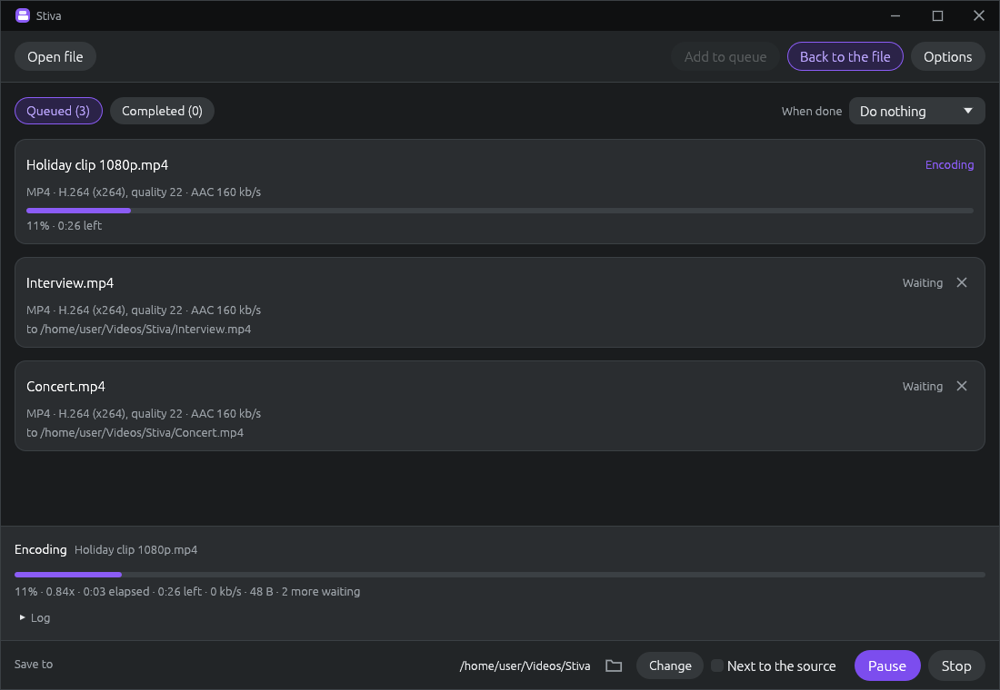

<div align="center">


# Stiva

**A plain, fast video converter for Windows 11 and Linux, built on ffmpeg.**

[](https://github.com/echidistanti/stiva/releases/latest)
[](https://github.com/echidistanti/stiva/actions/workflows/ci.yml)
[](LICENSE)
[](#install)
[](https://www.rust-lang.org)


</div>

I wanted a converter that stays close to ffmpeg without making me write command lines: open a file, pick a preset, press Encode. Stiva is that. The layout follows [VidCoder](https://github.com/RandomEngy/VidCoder), the look follows my other app [Camallo](https://github.com/echidistanti/camallo). It is a version 0.1 project, and the [test notes](#what-i-have-tested) say plainly what I have and have not tried.

## Features

- **Formats in and out.** Reads anything ffmpeg reads. Writes MP4, MKV, WebM, MP3, M4A, Opus and FLAC.
- **Video encoders.** x264, x265, SVT-AV1 and VP9 in software; AMD AMF, NVIDIA NVENC and Intel QSV in hardware, plus VA-API for AMD and Intel graphics on Linux (H.264, HEVC, AV1). 8-bit and 10-bit. Quality, bitrate or target file size, with two passes. SVT-AV1 has tune and film grain; every encoder, hardware included, takes extra ffmpeg options. Stiva tests each encoder on the machine and shows only those that really start.
- **Audio.** AAC, MP3, Opus, Vorbis, AC-3, FLAC, copy or none; mono, stereo or 5.1; choice of tracks.
- **Picture.** Size limit, crop (auto or manual), rotate, flip, deinterlace, detelecine, denoise, sharpen, grayscale and a free ffmpeg filter field.
- **Subtitles, chapters, time range.** Keep the tracks you want, chapters travel in MKV, encode only a stretch of the file.
- **Presets.** Eleven built in, your own saved as small JSON files you can export and import.
- **Queue.** Add files and leave. Pause, stop, run again. It survives closing the program.
- **When done.** Do nothing, open the folder, close Stiva, sleep or shut down.
- **System integration.** Drag and drop and a notification at the end on both systems. On Windows also progress on the taskbar button and a per-user installer; on Linux an AppImage.

<table>
<tr>
<td></td>
<td></td>
</tr>
</table>

<sub>Screenshots are rendered on Linux, where I build the program, with made-up file names. The Windows window is the same.</sub>

## Install

Download from the [latest release](https://github.com/echidistanti/stiva/releases/latest):

- **`stiva-<version>-windows-x64-setup.exe`**: installs for your user only, no administrator rights. Start menu entry, optional desktop shortcut. On uninstall it asks whether to remove Stiva's data too; it never touches your videos.
- **`stiva-<version>-windows-x64.7z`**: portable, a single `stiva.exe`.
- **`stiva-<version>-linux-x86_64.AppImage`**: one file for Linux. `chmod +x` it and run it; nothing is installed.

**ffmpeg.** On Windows, Stiva downloads it from [gyan.dev](https://www.gyan.dev/ffmpeg/builds/) on first start, verifies its SHA-256 and unpacks it. On Linux it never downloads without asking: if your system already has ffmpeg it offers to use that one, and otherwise (or if you prefer) it offers the full build from [FFmpeg-Builds](https://github.com/FFmpeg-Builds/FFmpeg-Builds), about 150 MB, also checked against its SHA-256. On both you can point to your own folder: *Options → ffmpeg*.

**Requirements:** a 64-bit system and a window of 900 × 600 or larger; a few hundred MB for a downloaded ffmpeg. Hardware encoding needs a card and driver that support it.

- *Windows 11.* Windows 10 may work; I have not checked.
- *Linux, x86-64.* A distribution with glibc 2.35 or newer (Ubuntu 22.04, Debian 12, Fedora 36 or later), X11 or Wayland, OpenGL 3.3 (Mesa is fine), and `xdg-desktop-portal` for the file dialogs, which every mainstream desktop has. AppImages need FUSE 2 (`libfuse2`; on Ubuntu 24.04 `libfuse2t64`), or start it with `--appimage-extract-and-run`.

Stiva is not code signed. See [Troubleshooting](#troubleshooting) if Windows or your antivirus complains.

## Using it

1. Open a file: *Open file*, `Ctrl+O`, drag and drop, or `stiva file.mp4` from the command line (the AppImage takes it as an argument too).
2. Pick a preset and adjust the tabs (*Container, Sizing, Filters, Video, Audio*). Every option explains itself in a line.
3. Check *Save to* (default `Videos\Stiva` or `~/Videos/Stiva`, or next to the source).
4. *Encode*, or *Add to queue* and open the next file. Several files at once go straight to the queue.

If the output name is taken, Stiva adds a number; *Options* can overwrite, skip or ask instead. Shortcuts: `Ctrl+O` open, `Ctrl+Enter` encode, `Space` pause and resume.

**Presets:** Web 1080p, Web 720p, Mobile 480p, Storage 1080p, Storage 720p, Archive H.265 10-bit, Small AV1 10-bit, WebM VP9 1080p, Music MP3 192, Music AAC 192, Lossless FLAC. *Save as…* keeps your own; *More* exports, imports or deletes them.

**When done:** sleep and shut down wait 15 and 60 seconds with *Cancel* and *Now*, run only if something was actually finished, and never force other programs. The choice is not remembered between runs. On Linux they ask systemd-logind, as the desktop's own power menu does; if the system wants a password for it (somebody else is logged in), Stiva says it could not.

## Data and privacy

Everything lives in `%LOCALAPPDATA%\Stiva` on Windows and `~/.local/share/stiva` on Linux: `settings.json`, `presets/`, `queue.json`, `bin/` (a downloaded ffmpeg), `logs/` (one per encode, plus `encoders.txt`). On Windows one registry key, `HKCU\Software\Classes\AppUserModelId\Stiva`, gives the notification its name and icon.

No accounts, no telemetry, no update check. The only network request is the ffmpeg download, and on Linux only if you ask for it. Stiva starts ffmpeg directly (never through a shell). Beyond that it uses `shutdown.exe` for *Shut down* on Windows and `xdg-open` on Linux to open a folder; the notification, sleep, shutdown and showing a file in the file manager go over D-Bus.

## What I have tested

I use Stiva on my own Windows 11 computer (AMD Ryzen, Radeon graphics) and have tried there: the first start and ffmpeg download, presets, the queue, pause and stop, 8-bit and 10-bit with x264, x265, SVT-AV1 and VP9, filters, bitrate, target size, two passes, subtitles, the notification, taskbar progress, every *When done* choice, the installer, and the **AMD AMF** encoders.

**Not tried on real hardware: NVIDIA NVENC, Intel QSV, VA-API and hardware AV1.** Stiva offers them only when ffmpeg can start them, but I have not looked at a file they made. Reports from such machines are the most useful thing you can send me.

**Linux is new.** I build and test it in a headless Linux session: the automated tests (CI runs them with the same ffmpeg build Stiva downloads), the window under a virtual display, the AppImage (CI starts it too), unpacking the real ffmpeg build and checking it against its published checksum, and the notification and *Show in folder* calls against a stand-in D-Bus. I have not yet used the AppImage on a real desktop or run the download from inside the program, so those, *Sleep* and *Shut down* on Linux, Wayland, and every GPU there are untried.

About a hundred automated tests run on Linux, including real ffmpeg encodes that check the command lines produce files with the right streams, size and length.

## Troubleshooting

- **SmartScreen or Defender warns, or removes the exe.** Stiva is new and unsigned, and it downloads and unpacks a program, which heuristics look at. SmartScreen: *More info → Run anyway*. Defender: *Protection history → restore → Allow on device*, then report a false positive at [microsoft.com/wdsi/filesubmission](https://www.microsoft.com/en-us/wdsi/filesubmission). The source is here and `cargo build --release` produces the same program.
- **ffmpeg will not download.** Check proxy or antivirus and retry, or point Stiva to your own ffmpeg folder (it needs `ffmpeg` and `ffprobe`, with `.exe` on Windows).
- **A hardware encoder is missing, or "10-bit did not pass its test".** The driver or card does not offer it; `logs/encoders.txt` shows what each test said. On Linux Stiva offers NVENC, Intel QSV where oneVPL is installed, and VA-API for AMD and Intel graphics. VA-API needs `libva` and your distribution's video driver (on Debian and Ubuntu `libva2` and `mesa-va-drivers`, or `intel-media-va-driver` for newer Intel); the ffmpeg Stiva downloads loads them from the system. AV1 encoding needs a recent chip (RDNA3 or Arc), so older ones show H.264 and HEVC only.
- **The AppImage does not start (Linux).** Most often FUSE 2 is missing: install `libfuse2` (`libfuse2t64` on Ubuntu 24.04), or run it as `./stiva-<version>-linux-x86_64.AppImage --appimage-extract-and-run`. If a file dialog never opens, your desktop has no `xdg-desktop-portal`; install the one for it.
- **The system's ffmpeg lacks an encoder (Linux).** Distributions sometimes build ffmpeg without x264, x265 or SVT-AV1. *Options → ffmpeg → Download ffmpeg* fetches the full build.
- **An encode failed.** The job's *Log* panel starts with the exact ffmpeg command and ends with what ffmpeg objected to. *Run again* retries it.

## Building from source

Rust 1.85 or newer.

```sh
cargo run                                              # debug build, Windows or Linux
STIVA_FFDIR=/usr/bin cargo test                        # tests; the folder must hold ffmpeg and ffprobe
cargo build --release                                  # on Windows (MSVC), as the releases are built
cargo build --release --target x86_64-pc-windows-gnu   # a Windows exe from Linux (mingw-w64)
packaging/linux/build-appimage.sh 0.1.2                # on Linux, after cargo build --release: dist/stiva-0.1.2-linux-x86_64.AppImage
```

Without ffmpeg, the tests that encode skip themselves. On Linux no extra packages are needed to build: the window, graphics and D-Bus libraries are loaded when the program starts.

**Releases are built by GitHub.** Publishing a release with a new tag starts `release.yml`, which builds `stiva.exe` on a Windows runner and attaches the `.7z`, builds the AppImage on Ubuntu 22.04 and attaches it, then `installer.yml` builds the setup with [Inno Setup](https://jrsoftware.org/isinfo.php) and attaches it. `ci.yml` builds both on every push, runs the tests and checks the formatting; its artifacts are the exe and the AppImage, kept for a week.

## Project layout

| Path | Contents |
| --- | --- |
| `src/app.rs`, `view.rs`, `ui.rs` | state and queue runner, screens, widgets and colours (egui) |
| `src/encode.rs`, `model.rs`, `filters.rs` | the ffmpeg command line, the settings it comes from, the filter chain |
| `src/caps.rs`, `probe.rs` | which encoders really start; reading files with ffprobe |
| `src/presets.rs`, `queue.rs`, `settings.rs` | presets, queue and settings, as JSON |
| `src/after.rs`, `platform.rs` | *When done*; notification, taskbar, sleep, shutdown and *Show in folder* (Windows Runtime or D-Bus) |
| `src/deps.rs`, `strings.rs` | finding, downloading and checking ffmpeg; every user-visible text |
| `installer/`, `packaging/linux/`, `.github/workflows/` | the Inno Setup script; the AppImage script and desktop entry; CI, release and installer workflows |

## Contributing

Bug reports are welcome. Please include the Stiva version, your system (Windows version, or Linux distribution and desktop, X11 or Wayland), the graphics card and driver, what you did and expected, and the job's log (*Log* panel, or the `logs` folder; `encoders.txt` for a missing encoder), with anything private removed. For a pull request, keep it small and make sure `cargo fmt` and the tests pass, user-visible texts live in `src/strings.rs`, and code for one system sits behind `#[cfg(windows)]` or `#[cfg(not(windows))]` with the other system covered.

## Known limits

- Not code signed.
- English interface only (the installer also speaks Italian).
- Queue rows cannot be selected, so there is no `Delete` key; each row has its own remove button.
- Linux: VA-API has no speed setting (drivers do not agree on one), no progress on the taskbar or dock, and the window is drawn by Stiva (title bar included), not by the desktop.
- Windows 11 and AMD AMF are the only system and hardware encoder I have tried.

## Credits

[ffmpeg](https://ffmpeg.org) does all the encoding; it is downloaded, not bundled, and has its own licence (GPL v3 for the full builds used, from gyan.dev and [FFmpeg-Builds](https://github.com/FFmpeg-Builds/FFmpeg-Builds)). Built with [egui](https://github.com/emilk/egui), [rfd](https://github.com/PolyMeilex/rfd), [ureq](https://github.com/algesten/ureq), [serde](https://serde.rs), [sevenz-rust2](https://github.com/hasenbanck/sevenz-rust2), [zbus](https://github.com/z-galaxy/zbus), [windows-rs](https://github.com/microsoft/windows-rs), [Inno Setup](https://jrsoftware.org/isinfo.php) and [appimagetool](https://github.com/AppImage/appimagetool). The layout is inspired by VidCoder; no code from it is used.

## Licence

MIT. See [LICENSE](LICENSE).
